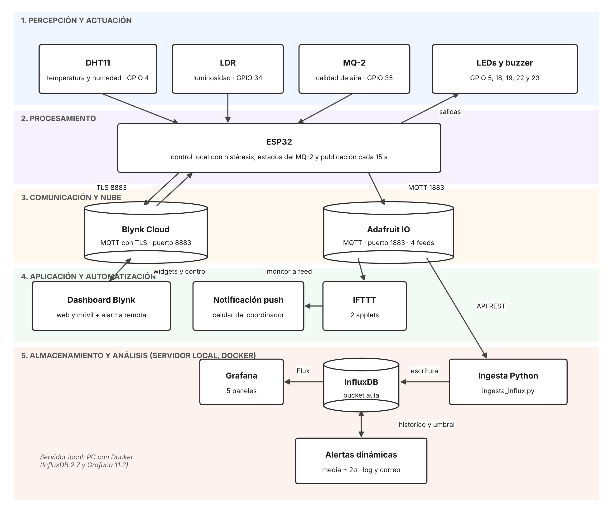

# Sistema IoT de Monitoreo Ambiental y Alertas Tempranas para Aulas (ESP32)

Proyecto integrador de **Internet de las Cosas (UTS)**, grupo B192.
**Autores:** Jackson Romero y Sara Santos · **Docente:** Eliecer Montero Ojeda

Un ESP32 mide **temperatura, humedad, luminosidad y calidad de aire** (DHT11, LDR y MQ-2), controla localmente
cuatro LEDs y un buzzer, y publica los datos en la nube. Los datos alimentan un dashboard móvil, alertas en el
celular, un histórico en InfluxDB, un dashboard de Grafana y una alerta estadística con umbral dinámico.

## Arquitectura

| Capa | Componentes |
|---|---|
| Percepción y actuación | DHT11 (GPIO 4), LDR (GPIO 34), MQ-2 (GPIO 35), LEDs (GPIO 5, 18, 19, 22) y buzzer (GPIO 23) |
| Procesamiento | ESP32 con control local (histéresis y estados del MQ-2) |
| Comunicación y nube | **Blynk** (MQTT con TLS, 8883) y **Adafruit IO** (MQTT, 1883) |
| Aplicación y automatización | Dashboard de Blynk (web y móvil, alarma remota) e **IFTTT** (notificaciones push) |
| Almacenamiento y análisis | Script de ingesta → **InfluxDB** → **Grafana**; script de alertas dinámicas |



## Estructura del repositorio

```
├── docker-compose.yml        InfluxDB 2.7 + Grafana 11.2
├── .env.example              plantilla de contraseñas locales
├── firmware/monitor_aula_final/
│   ├── monitor_aula_final.ino
│   └── config.example.h      plantilla de credenciales del ESP32
├── python/
│   ├── ingesta_influx.py     Adafruit IO -> InfluxDB
│   ├── migrar_sqlite.py      SQLite (semana 14) -> InfluxDB
│   ├── simular_aulas.py      histórico y aula2 simulados (origen=simulado)
│   ├── alerta_dinamica.py    umbral = media + 2 desviaciones, log y correo
│   ├── inyectar_anomalia.py  simula una anomalía
│   ├── consultar.py          cuenta los puntos guardados
│   └── config.example.py     plantilla de credenciales de Python
├── grafana/
│   ├── dashboards/monitoreo_aula.json
│   └── provisioning/
└── docs/capturas/
```

## Cómo replicar

1. **Circuito:** montar el ESP32 con el DHT11, el LDR, el MQ-2 (con divisor 10 kΩ / 20 kΩ), 4 LEDs y el buzzer según los pines de la tabla.
2. **Blynk:** crear el template con los datastreams `temperatura`, `humedad`, `luminosidad`, `calidad_aire` y `alarma_remota`; crear el dispositivo y copiar su token.
3. **Adafruit IO:** crear los feeds `temperatura`, `humedad`, `luminosidad` y `calidad-aire`; copiar el usuario y la AIO Key.
4. **Firmware:** copiar `config.example.h` como `config.h`, rellenarlo y subir `monitor_aula_final.ino` (librerías: PubSubClient y DHT sensor library).
5. **Servidor local:** copiar `.env.example` como `.env` y ejecutar `docker compose up -d`.
   InfluxDB en http://localhost:8086 y Grafana en http://localhost:3000.
6. **Python:** en `python/`, copiar `config.example.py` como `config.py`, rellenarlo y ejecutar `pip install -r requirements.txt`.
   Luego `python ingesta_influx.py` (datos reales) y `python alerta_dinamica.py` (alertas).
7. **IFTTT:** crear dos applets con el disparador *Monitor a feed on Adafruit IO*: `calidad-aire` mayor que 700 y `temperatura` mayor que 30.

## Alertas

1. **Locales:** LEDs y buzzer, decididos por el ESP32 (no dependen de internet).
2. **IFTTT:** notificación push al celular ante aire malo o temperatura alta.
3. **Dinámica:** umbral = μ + 2σ calculado sobre el histórico de InfluxDB; registra en `alertas.log` y, si se activa, envía correo.

## Datos simulados

El proyecto tiene un solo ESP32 (aula1). La segunda aula y el histórico de la semana se generan con
`simular_aulas.py` y llevan siempre la etiqueta `origen=simulado`.

## Seguridad de credenciales

`config.h`, `config.py` y `.env` están en `.gitignore` y **no se suben**. Solo se versionan las plantillas `*.example.*`.

## Informe de la entrega

* **Informe en Word:** [Ver Informe de la Entrega](docs/capturas/Semana_Dieciseis_Informe_Romero_Santos.docx)
