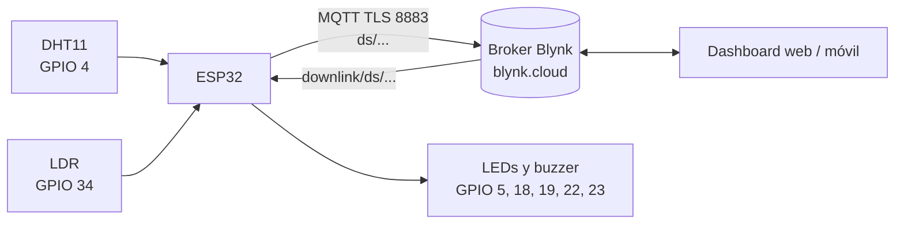
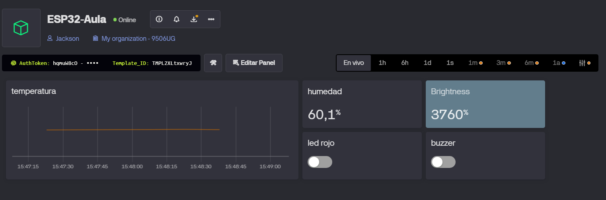
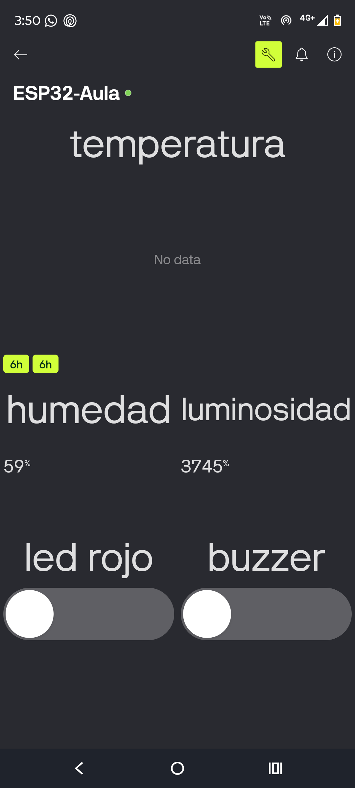
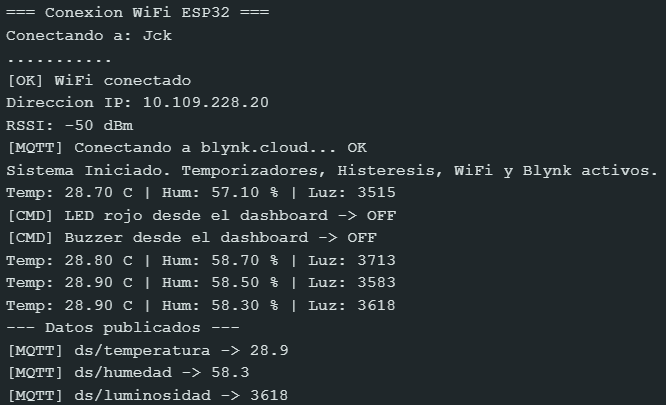

# Monitor de Aula Conectado (ESP32 + Blynk)

Proyecto integrador de **Internet de las Cosas (UTS)**: monitoreo inteligente de un aula.
Un ESP32 lee temperatura, humedad y luminosidad, las publica por MQTT en **Blynk** y permite
controlar un LED rojo y un buzzer desde un dashboard web/móvil.

**Autores:** Jackson Romero y Sara Santos

## Arquitectura

## Hardware

| Componente | GPIO |
|---|---|
| DHT11 | 4 |
| LDR (divisor con 10 kΩ) | 34 |
| LED amarillo | 5 |
| LED rojo | 18 |
| LED verde | 19 |
| LED blanco | 22 |
| Buzzer | 23 |

## Datastreams en Blynk

| Nombre | Tipo | Dirección | Widget |
|---|---|---|---|
| `temperatura` | Double | ESP32 → Blynk | Chart (histórico) |
| `humedad` | Double | ESP32 → Blynk | Gauge |
| `luminosidad` | Integer (0–4095) | ESP32 → Blynk | Label con color por rango |
| `led_rojo` | Integer (0/1) | Blynk → ESP32 | Switch |
| `buzzer` | Integer (0/1) | Blynk → ESP32 | Switch |

Tópicos MQTT usados: `ds/<datastream>` (publicar) y `downlink/ds/<datastream>` (recibir comandos).

## Cómo replicar el proyecto

1. Instala en Arduino IDE el soporte de **ESP32** y las librerías **PubSubClient** (Nick O'Leary),
   **DHT sensor library** y **Adafruit Unified Sensor** (Adafruit).
2. Crea una cuenta en [blynk.cloud](https://blynk.cloud), un *Template* con los cinco datastreams
   de la tabla anterior y un dispositivo. Copia su **Auth Token**.
3. Copia `config.example.h` como `config.h` y rellena `WIFI_SSID`, `WIFI_PASSWORD` y `BLYNK_AUTH_TOKEN`.
4. Abre `monitor_aula_blynk.ino`, selecciona tu placa ESP32 y sube el código.
5. Abre el Monitor Serial a **115200** baudios y verifica `[MQTT] Conectando a blynk.cloud... OK`.
6. Construye el dashboard (web y/o móvil) con los widgets de la tabla.

## Seguridad de credenciales

`config.h` contiene el WiFi y el token y está en `.gitignore`. Solo se versiona `config.example.h`.
La conexión usa TLS (puerto 8883) con `setInsecure()`, es decir, cifra el tráfico pero no valida el
certificado del servidor; es suficiente para la práctica, no para producción.

## Capturas del dashboard

- Dashboard web: 
- Dashboard móvil: 
- Monitor Serial recibiendo comandos: 

## Informe de la Semana 12

**Informe en Word:** [Ver Informe de la Entrega](Semana_Doce_Informe_Romero_Santos.docx)

## Video de demostración

**Link al Video:** [Ver Video en Youtube](https://youtu.be/kxVUArSmjg0)

