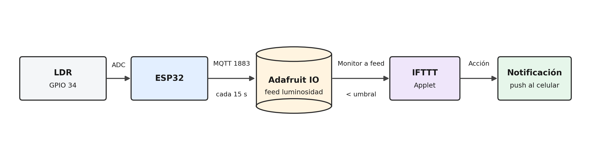
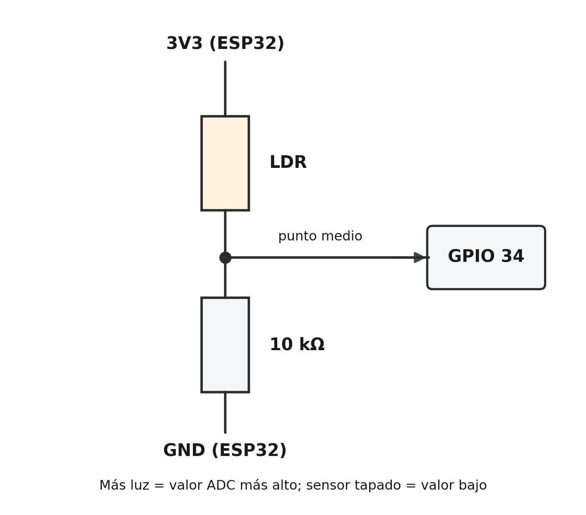
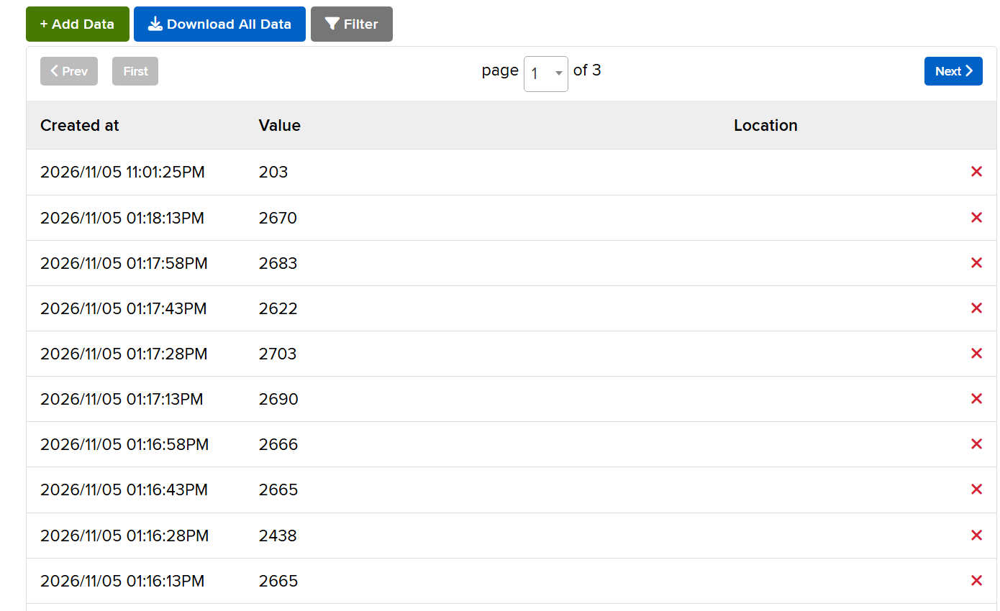
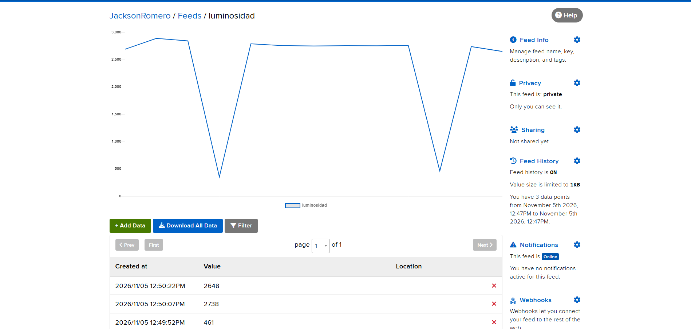
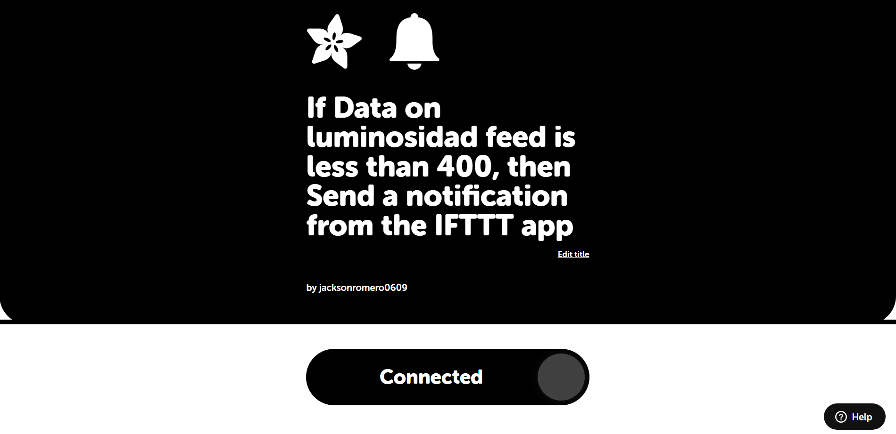
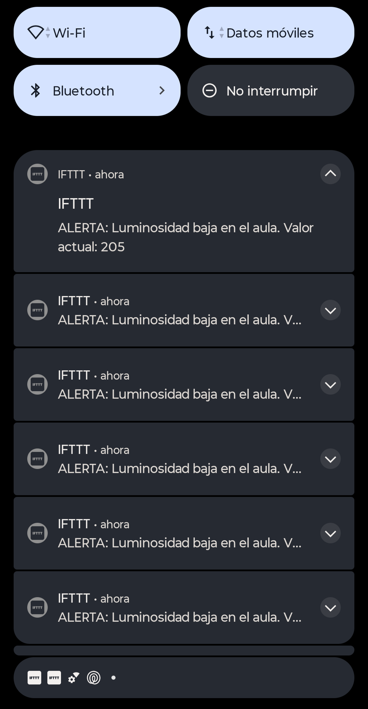

# Semana 13: Alerta de luminosidad en el aula (ESP32 + Adafruit IO + IFTTT)

Proyecto integrador de **Internet de las Cosas (UTS)**, grupo B192.

**Autores:** Jackson Romero y Sara Santos
**Docente:** Eliecer Montero Ojeda

## Descripción del proyecto

El coordinador académico no puede permanecer frente al dashboard todo el día, pero necesita enterarse
de inmediato cuando ocurre una anomalía en el aula, por ejemplo una caída fuerte de la luminosidad
(que simula el encendido de luces o un cambio ambiental crítico).

Este proyecto resuelve esa necesidad con un flujo completo de IoT: un **ESP32** lee la luminosidad con un
**LDR**, la publica por MQTT en un feed de **Adafruit IO** y un applet de **IFTTT** vigila ese feed. Cuando el
valor cae por debajo del umbral, IFTTT envía una **notificación push** al celular del coordinador.

## Flujo del sistema

**Sensor → ESP32 → Adafruit IO → IFTTT → Notificación push**



1. **Sensor:** el LDR, conectado en un divisor de voltaje, entrega un valor analógico al GPIO 34.
2. **ESP32:** promedia 10 muestras del ADC y publica el valor cada 15 segundos por MQTT.
3. **Adafruit IO:** recibe el dato en el feed `luminosidad` y guarda el histórico.
4. **IFTTT:** el applet (disparador *Monitor a feed on Adafruit IO*) evalúa el feed y detecta cuando el valor es menor que el umbral.
5. **Notificación push:** IFTTT envía el aviso a la aplicación de IFTTT instalada en el celular.

## Materiales

| Recurso | Descripción |
|---|---|
| Hardware | ESP32 (placa de desarrollo), LDR, resistencia de 10 kΩ, protoboard y jumpers |
| Software | Arduino IDE 2.3.10, placa ESP32 Dev Module, librería PubSubClient |
| Cuentas | Adafruit IO (gratuita), IFTTT (gratuita), GitHub, aplicación de IFTTT en el celular |
| Red | Conexión WiFi con acceso a Internet |

## Diagrama de conexión del sensor



| Elemento | Conexión |
|---|---|
| LDR, pata 1 | 3V3 |
| LDR, pata 2 | Punto medio, conectado al **GPIO 34** |
| Resistencia de 10 kΩ | Entre el punto medio y GND |

Con este montaje, a mayor luz el valor leído es más alto; al tapar el sensor el valor baja.

> **Unidades:** el LDR entrega valores del ADC del ESP32 (0 a 4095), no lux reales. Para medir lux
> se necesita un sensor calibrado como el BH1750. El umbral de la alerta está definido sobre las
> unidades del ADC.

## Cómo replicar el proyecto

1. Arma el circuito de la tabla anterior.
2. En Arduino IDE instala el soporte para **ESP32** y la librería **PubSubClient** (Nick O'Leary).
3. Crea una cuenta en [io.adafruit.com](https://io.adafruit.com) y un feed llamado `luminosidad`
   (en minúsculas). Copia tu *Username* y tu *AIO Key*.
4. Copia `codigo/config.example.h` como `config.h` (en la misma carpeta que el `.ino`) y rellena el WiFi,
   `AIO_USERNAME` y `AIO_KEY`.
5. Abre `esp32_luminosidad.ino` (la carpeta del sketch debe llamarse igual que el archivo), selecciona
   **ESP32 Dev Module** y sube el código.
6. Abre el Monitor Serial a **115200** baudios y verifica `[MQTT] Conectando a io.adafruit.com... OK`.
7. En Adafruit IO crea un dashboard con un bloque **Line Chart** asociado al feed `luminosidad`.
8. Crea el applet de IFTTT (siguiente sección) e instala la aplicación de IFTTT en tu celular con la misma cuenta.

## Configuración de Adafruit IO

| Parámetro | Valor |
|---|---|
| Servidor | io.adafruit.com |
| Puerto | 1883 |
| Usuario MQTT | Nombre de usuario de Adafruit IO |
| Contraseña MQTT | AIO Key |
| Tópico de publicación | `usuario/feeds/luminosidad` |
| Frecuencia de publicación | Cada 15 segundos |

## Applet de IFTTT

| Elemento | Configuración |
|---|---|
| **This** (disparador) | Servicio *Adafruit* → *Monitor a feed on Adafruit IO* |
| Feed | `luminosidad` |
| Condición | *Less than* (menor que) **[COMPLETAR: umbral usado]** |
| **That** (acción) | Servicio *Notifications* → *Send a notification from the IFTTT app* |
| Mensaje | `ALERTA: Luminosidad baja en el aula. Valor actual: {FeedValue} lux. Verificar iluminación.` |

El valor actual se inserta con el ingrediente **FeedValue** del disparador. IFTTT consulta el feed de forma
periódica (*polling*); en el plan gratuito esa consulta es menos frecuente que en los planes de pago, por lo que
la notificación puede tardar en llegar.

## Evidencias

**Feed de Adafruit IO con datos en tiempo real**



**Gráfico histórico (Line Chart)**



**Applet de IFTTT configurado y activo**



**Notificación push recibida en el celular**



## Estructura del repositorio

```
proyecto-iot-semana13/
├── README.md
├── .gitignore
├── codigo/
│   ├── esp32_luminosidad.ino
│   └── config.example.h
├── evidencias/
│   ├── applet_ifttt.png
│   ├── notificacion_push.png
│   ├── grafico_historico.png
│   ├── dashboard_adafruit.png
│   ├── flujo_semana13.png
│   └── conexion_ldr_esp32.png
└── informe_tecnico.docx
```

## Seguridad de credenciales

El WiFi y la AIO Key se guardan en `config.h`, que está incluido en `.gitignore` y **no se sube a GitHub**.
En el repositorio solo está `config.example.h`, con valores de ejemplo.

## Código fuente

Archivo `codigo/esp32_luminosidad.ino`:

```cpp
/*
 * SEMANA 13 - Alerta de luminosidad con IFTTT
 * Flujo: LDR -> ESP32 -> Adafruit IO -> IFTTT -> notificacion push
 *
 * Base: codigo MQTT de las semanas 10 y 12 (WiFi + millis + reconexion).
 * Cambios: se lee solo el LDR (ya no el DHT11) y se publica en el feed
 *          "luminosidad" de Adafruit IO cada 15 segundos.
 *
 * Libreria requerida: PubSubClient (Nick O'Leary)
 * Credenciales: se leen de config.h (NO se sube a GitHub).
 */

#include <WiFi.h>
#include <PubSubClient.h>
#include "config.h"

// ==========================================
// 1. CONFIGURACION
// ==========================================
const char* ssid     = WIFI_SSID;
const char* password = WIFI_PASSWORD;

const char* mqtt_server = "io.adafruit.com";
const int   mqtt_port   = 1883;

// En Adafruit IO el topico de un feed es: usuario/feeds/nombre_feed
String topicLuz = String(AIO_USERNAME) + "/feeds/luminosidad";

// ==========================================
// 2. PINES Y OBJETOS
// ==========================================
#define LDR_PIN 34   // entrada analogica (ADC) del divisor de voltaje del LDR

WiFiClient espClient;
PubSubClient client(espClient);
String clientId;

// ==========================================
// 3. VARIABLES DE TIEMPO (millis, sin delay largos)
// ==========================================
unsigned long tiempoAnteriorWiFi = 0;
unsigned long tiempoAnteriorMQTT = 0;
unsigned long tiempoAnteriorLectura = 0;
unsigned long ultimoEnvio = 0;
const unsigned long INTERVALO_ENVIO = INTERVALO_ENVIO_MS;  // 10-15 s recomendado para IFTTT

int valorLuminosidad = 0;
bool hayLectura = false;

// ==========================================
// 4. FUNCIONES
// ==========================================

// Promedio de 10 muestras para suavizar el ruido del ADC
int leerLuminosidad() {
  long suma = 0;
  for (int i = 0; i < 10; i++) {
    suma += analogRead(LDR_PIN);
    delay(2);
  }
  return (int)(suma / 10);
}

void conectarWiFi() {
  Serial.println("\n=== Conexion WiFi ESP32 ===");
  Serial.print("Conectando a: ");
  Serial.println(ssid);

  WiFi.begin(ssid, password);

  unsigned long inicio = millis();
  while (WiFi.status() != WL_CONNECTED && (millis() - inicio) < 20000) {
    delay(500);
    Serial.print(".");
  }

  if (WiFi.status() == WL_CONNECTED) {
    Serial.println("\n[OK] WiFi conectado");
    Serial.print("RSSI: ");
    Serial.print(WiFi.RSSI());
    Serial.println(" dBm");
  } else {
    Serial.println("\n[ERROR] No se pudo conectar al WiFi");
  }
}

// Intento unico y no bloqueante: se llama cada 5 s desde loop()
void reconnect() {
  Serial.print("[MQTT] Conectando a ");
  Serial.print(mqtt_server);
  Serial.print("... ");

  // Adafruit IO: usuario = nombre de usuario, contrasena = AIO Key
  if (client.connect(clientId.c_str(), AIO_USERNAME, AIO_KEY)) {
    Serial.println("OK");
  } else {
    Serial.print("Fallo, rc=");
    Serial.println(client.state());
  }
}

void publicarLuminosidad() {
  char buf[12];
  snprintf(buf, sizeof(buf), "%d", valorLuminosidad);

  if (client.publish(topicLuz.c_str(), buf)) {
    Serial.print("[MQTT] Publicado en ");
    Serial.print(topicLuz);
    Serial.print(" -> ");
    Serial.println(valorLuminosidad);
  } else {
    Serial.println("[MQTT] Error al publicar");
  }
}

// ==========================================
// 5. SETUP
// ==========================================
void setup() {
  Serial.begin(115200);
  delay(1000);

  clientId = "ESP32_Luz_" + String((uint32_t)ESP.getEfuseMac(), HEX);

  conectarWiFi();

  client.setServer(mqtt_server, mqtt_port);
  client.setKeepAlive(30);

  Serial.println("Sistema iniciado: LDR -> Adafruit IO (feed luminosidad)");
}

// ==========================================
// 6. LOOP
// ==========================================
void loop() {
  unsigned long tiempoActual = millis();

  // --- Reconexion WiFi cada 10 s ---
  if ((WiFi.status() != WL_CONNECTED) && (tiempoActual - tiempoAnteriorWiFi >= 10000)) {
    Serial.println("\n[ALERTA] Conexion WiFi perdida. Intentando reconectar...");
    WiFi.disconnect();
    WiFi.reconnect();
    tiempoAnteriorWiFi = tiempoActual;
  }

  // --- Mantener la sesion MQTT ---
  if (WiFi.status() == WL_CONNECTED) {
    if (!client.connected()) {
      if (tiempoActual - tiempoAnteriorMQTT >= 5000) {
        tiempoAnteriorMQTT = tiempoActual;
        reconnect();
      }
    } else {
      client.loop();
    }
  }

  // --- Lectura del LDR cada 2 s ---
  if (tiempoActual - tiempoAnteriorLectura >= 2000) {
    tiempoAnteriorLectura = tiempoActual;
    valorLuminosidad = leerLuminosidad();
    hayLectura = true;

    Serial.print("Luminosidad (ADC 0-4095): ");
    Serial.println(valorLuminosidad);
  }

  // --- Publicacion periodica ---
  if (client.connected() && hayLectura && (tiempoActual - ultimoEnvio >= INTERVALO_ENVIO)) {
    ultimoEnvio = tiempoActual;
    publicarLuminosidad();
  }
}
```

Archivo `codigo/config.example.h`:

```cpp
// ==========================================================
// config.example.h  ->  COPIA este archivo como "config.h"
// y rellena tus datos reales. "config.h" NO se sube a GitHub.
// ==========================================================
#pragma once

#define WIFI_SSID        "TU_WIFI"
#define WIFI_PASSWORD    "TU_CLAVE_WIFI"

// Adafruit IO: tu nombre de usuario y tu AIO Key (clave amarilla en io.adafruit.com)
#define AIO_USERNAME     "TU_USUARIO_ADAFRUIT"
#define AIO_KEY          "TU_AIO_KEY"

// Cada cuantos milisegundos se publica la luminosidad (10000 a 15000 recomendado)
#define INTERVALO_ENVIO_MS 15000
```

## Conclusiones

- La automatización con IFTTT convierte un sistema que solo muestra datos en uno que **avisa por sí mismo**:
  el coordinador ya no tiene que mirar el dashboard, porque la alerta le llega al celular cuando ocurre la anomalía.
- Separar la captura del dato (ESP32), el almacenamiento (Adafruit IO) y la lógica de la alerta (IFTTT) mantiene
  el firmware simple: cambiar el umbral o el tipo de aviso se hace desde IFTTT, sin reprogramar la placa.
- Publicar cada 15 segundos y controlar los tiempos con `millis()` en lugar de `delay()` largos mantiene estable
  la conexión MQTT.
- Limitaciones del plan gratuito: retención de datos de 30 días en Adafruit IO, solo 2 applets activos en IFTTT y
  una consulta menos frecuente del disparador, por lo que la alerta no es inmediata.
- El LDR no mide lux reales. Como mejora se puede usar un sensor BH1750 y registrar las alertas en una hoja de
  cálculo para conservar un histórico más largo.
